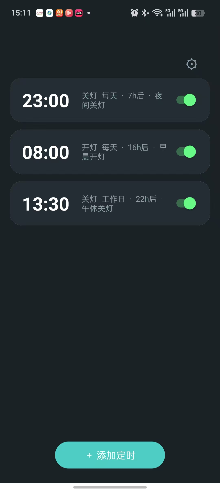
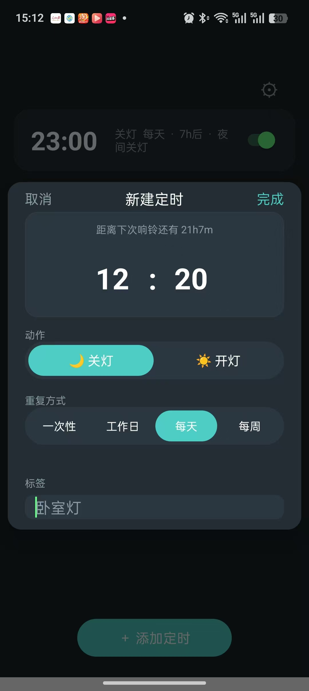
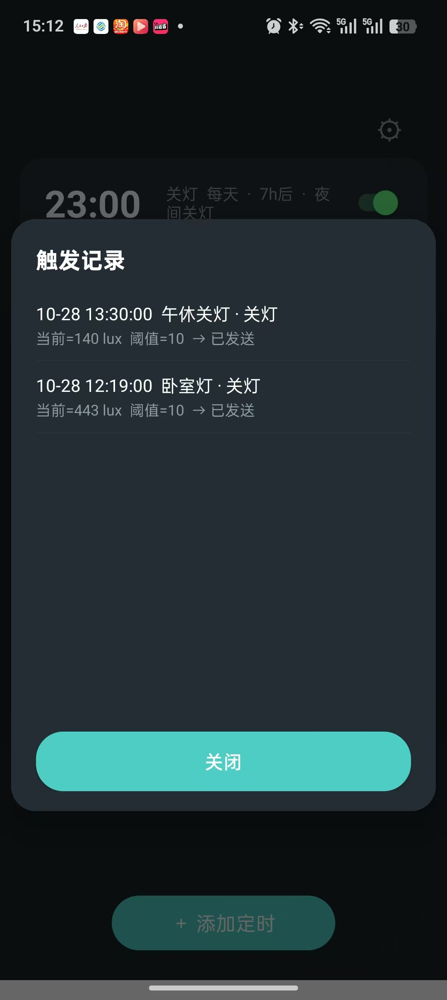

# LightTimer · 红外定时遥控灯 App

手机上纯应用级的定时红外遥控工具。到点后先读光线传感器判断灯的当前状态，再用红外 toggle 码补一次状态切换，实现定时触发「灯亮着就跳过、灯灭了才补发」。

---

## 一、背景

- 场景：手机常驻卧室，控制 TCL 吸顶灯（红外遥控器 rid=8259）。默认两个定时：**23:00 关灯、08:00 开灯**，均可编辑。
- 硬约束：**免解锁**、**纯应用级**、**不引入任何硬件**、**无 root**。
- 两个真实阻碍：
  1. 遥控码不在系统里。OPPO 自带红外 App 用的是**酷控 SDK（Kookong）** 的加密码库，离线库 `pulse_data` 是加密 blob，云端接口响应也是密文，第三方 App 无法直接取用。
  2. ColorOS 对后台定时有额外限制，锁屏后进程可能被冻结，普通 `AlarmManager` 定时不可靠。

---

## 二、结果


| 主界面 | 添加定时 | 触发回溯 |
|:---:|:---:|:---:|
|  |  |  |

- 交付物是一个可直接 `adb install` 的 APK（约 46KB），**11 个 Java 文件，无 Gradle、无 Android Studio、无 XML 布局**，全命令行构建。
- 已实机验证的链路：
  - 锁屏熄屏状态下，精确闹钟照常触发 `BroadcastReceiver`，红外码成功发出
  - 开机后自动重排全部定时（`BOOT_COMPLETED`）
  - 定时界面支持增删改、启停、左滑删除；四种重复模式（每天 / 工作日 / 每周 / 一次性）
  - 灯光状态判定：低于阈值（默认 10 lux）视为灯灭；传感器读取失败一律跳过
  - 工作日按法定节假日执行：内置 2026 年国务院公告表兜底，启动/开机时自动从在线数据源同步并按年缓存
  - 设置页可查看每次触发的记录（含触发时的 lux、阈值、执行结果）与节假日同步状态
- 唯一需要用户手动完成的一步：系统设置里给 LightTimer 开启**自启动 + 允许后台活动**（ColorOS 不允许 adb 修改）。

---

## 三、技术核心

### 3.1 运行链路

```
setAlarmClock 到点
  ↓
IrAlarmReceiver（PARTIAL_WAKE_LOCK 10s + goAsync 延长时间窗）
  ↓
取该条定时 → 光线采样 2s 超时、3 次取中位数
  ↓
当前状态 == 目标状态？ ──── 是 → 记录「跳过」（toggle 码重发会反向）
  ↓ 否
ConsumerIrManager.transmit(38180Hz, toggle 码) → 重排下一次
```

- 传感器失败 → **一律跳过**（宁可漏触发，不可误触发）。
- 每条定时使用**独立 requestCode**（= item id），否则多条 `PendingIntent` 会互相覆盖。
- 调度用 `setAlarmClock`（可见闹钟图标、ColorOS 下更可靠），抛 `SecurityException` 时降级 `setAndAllowWhileIdle`。

### 3.2 码源：逆出酷控 SDK 的解密

- 酷控 SDK（`com.kookong.sdk`，`libkksdk.so`）为 OPPO / 小米 / 荣耀等多家红外 App 共用的底层码库，离线库与云端响应都加密。
- 云端接口 `https://sdk2.kookong.com/m/irs` **接受明文参数**，无需签名体；响应密文的**前 4 字节就是密钥**，按 `b0 | b2<<8 | b3<<16 | b1<<24` 组成 int32。
- 其后为分块变换（块长 1..8 循环，块内逆序折叠 64 位整数、`key` 参与截断除法与移位异或），解完再 GZIP 得到明文 JSON。算法已在 `kookong/decryptor.py` 精确复现。
- 结果落盘：`out/rid8259_bin0.json` 明文码表（11 个按键）、`out/pattern.txt` power 键 72 段时序。**码表与手机状态无关，离线可用。**

### 3.3 时间判定

| 重复模式 | 计算方式 |
|---|---|
| 每天 | 今天或明天 HH:MM |
| 每周 | 从今天起找第一个命中 `weekdayMask` 的日期 |
| 工作日 | 按节假日表跳过休息日，调休补班日照常 |
| 一次性 | 指定日期触发后自动禁用 |

工作日数据源：内置 2026 年放假/补班表作为离线兜底；在线数据（`NateScarlet/holiday-cn`，多镜像回退）仅用于补数据——启动/开机时后台同步，成功过 3 天内不再请求、失败 6 小时后重试，判定时只读本地缓存，断网不影响。

### 3.4 数据模型

```java
public class Item {
    int id;                            // 唯一自增 id，也是 AlarmManager 的 requestCode
    int hour, minute;                  // 触发时间
    boolean enabled;                   // 是否启用
    String label;                      // 标签，留空保存为「卧室灯」
    int action;                        // ACTION_ON(1) / ACTION_OFF(0)
    int repeat;                        // DAILY(0) / WEEKLY(1) / ONCE(2) / WEEKDAY(3)
    int weekdayMask;                   // WEEKLY: bit0=周一 … bit6=周日
    int onceYear, onceMonth, onceDay;  // ONCE: 指定日期
}
```

### 3.5 源码结构

```
app/
├── AndroidManifest.xml                权限 + Activity/两个 Receiver
├── lt.jks                             签名（必须保留，换签名需先卸载）
├── src/com/lighttimer/
│   ├── MainActivity.java              全部 UI（手写 View，无 XML 布局）+ 设置页
│   ├── AlarmStore.java                Item JSON 持久化 + 首次启动默认两条定时
│   ├── AlarmScheduler.java            setAlarmClock + 四种重复的 nextTrigger
│   ├── IrAlarmReceiver.java           WakeLock + goAsync + 光线判定 + 发射 + 触发记录
│   ├── BootReceiver.java              开机/覆盖安装后重排 + 触发节假日同步
│   ├── HolidayApi.java                在线节假日拉取、按年缓存、同步状态记录
│   ├── Holiday.java                   工作日判定（在线缓存 → 内置表 → 周末规则）
│   ├── SenseConfig.java               lux 阈值（默认 10，可调）
│   ├── LightSensor.java               采样取中位数防抖
│   ├── IrSender.java                  ConsumerIrManager 发码
│   └── FileLog.java                   外部存储日志，超 500KB 截半
└── res/
    ├── values/colors.xml              深色主题（#1A2226 / #232D33 / #4ECDC4）
    ├── values/themes.xml              statusBarColor + windowLightStatusBar=false
    ├── drawable/                      图标与胶囊背景
    └── mipmap-anydpi-v26/ic_launcher.xml
kookong/decryptor.py                   酷控解密算法复现
kookong/fetch_ir.py                    拉取云端码表
out/                                   明文码表与时序（rid8259）
```

---

## 四、命令行应用说明

### 4.1 构建（无需 Gradle）

```bash
cd app
export PATH=/opt/homebrew/opt/openjdk/bin:$PATH
ANDROID_JAR=/opt/homebrew/share/android-commandlinetools/platforms/android-34/android.jar
BT=/opt/homebrew/share/android-commandlinetools/build-tools/34.0.0

rm -rf build && mkdir -p build/flat build/gen build/classes build/dex

# 1) 资源编译 + 链接（-o 必须带尾斜杠，否则产出同名 zip 导致 *.flat 匹配不到）
$BT/aapt2 compile --dir res -o build/flat/
$BT/aapt2 link -o build/base.apk -I $ANDROID_JAR --manifest AndroidManifest.xml \
    -R build/flat/*.flat --java build/gen --min-sdk-version 26 --target-sdk-version 34

# 2) 编译 Java（必须加 -parameters：JDK 27 编译匿名内部类会写空名字的 MethodParameters，
#    build-tools 34 的 d8 读到空名字会 NPE：Cannot invoke "String.length()"）
javac --release 11 -parameters -cp $ANDROID_JAR -d build/classes \
    src/com/lighttimer/*.java build/gen/com/lighttimer/R.java

# 3) 转 dex 并塞回 APK
$BT/d8 --lib $ANDROID_JAR --min-api 26 --output build/dex build/classes/com/lighttimer/*.class
cp build/base.apk build/unsigned.apk
(cd build/dex && zip -q -uj ../unsigned.apk classes.dex)

# 4) 对齐 + 签名
$BT/zipalign -f 4 build/unsigned.apk build/aligned.apk
$BT/apksigner sign --ks lt.jks --ks-pass pass:lighttimer --out LightTimer.apk build/aligned.apk
```

### 4.2 安装与运行

| 操作 | 命令 |
|---|---|
| 安装/覆盖安装 | `adb install -r LightTimer.apk` |
| 换签名后安装 | `adb uninstall com.lighttimer && adb install LightTimer.apk` |
| 启动 App | `adb shell am start -n com.lighttimer/.MainActivity` |
| 恢复首次启动状态 | 系统设置 → 应用管理 → LightTimer → 清除存储 |

### 4.3 调试

| 操作 | 命令 |
|---|---|
| 模拟触发某条定时（uid 为定时 id） | `adb shell am broadcast -a com.lighttimer.FIRE -n com.lighttimer/.IrAlarmReceiver --ei uid 1 -f 0x20` |
| 发一次测试红外（不走光线判定） | `adb shell am broadcast -a com.lighttimer.TEST -n com.lighttimer/.IrAlarmReceiver -f 0x20` |
| 看 App 文件日志（锁屏后 logcat 会被清，这里不会） | `adb shell cat /sdcard/Android/data/com.lighttimer/files/log.txt \| tail -30` |
| 看触发记录 | `adb shell "grep '#FIRE' /sdcard/Android/data/com.lighttimer/files/log.txt \| tail -10"` |
| 看节假日同步结果 | `adb shell "grep -i holiday /sdcard/Android/data/com.lighttimer/files/log.txt \| tail -5"` |
| 看系统已注册的闹钟 | `adb shell dumpsys alarm \| grep -A8 "com.lighttimer"` |
| 加 Doze 白名单 | `adb shell dumpsys deviceidle whitelist +com.lighttimer` |
| 实时看运行日志 | `adb logcat -s LT:* AndroidRuntime:E` |
| 卸载 | `adb uninstall com.lighttimer` |

> Doze 白名单**不等于** ColorOS 的自启动权限。锁屏后定时失效时，先去系统设置 → 应用 → LightTimer → 打开「允许自启动」与「允许后台活动」。


### 4.4 数据位置

| 数据 | 位置 |
|---|---|
| 定时列表 | `/data/data/com.lighttimer/files/alarms.json`（需 root 或调试包才能读） |
| 光线阈值 | SharedPreferences `sense`，key `lux_threshold` |
| 节假日缓存 | SharedPreferences `holiday_api`，按年/按日缓存 + 同步状态 |
| 运行日志 | `/sdcard/Android/data/com.lighttimer/files/log.txt` |

---

## License

Internal use only.
